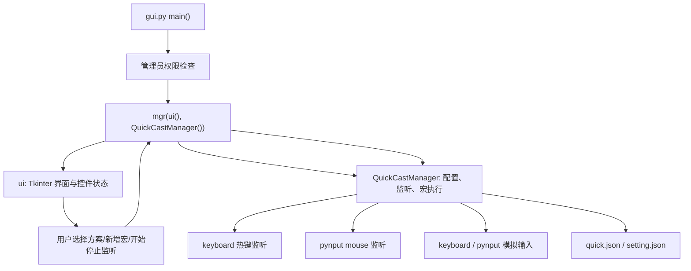

# 基础架构

## 技术栈

- 语言：Python
- UI：Tkinter / ttk
- 键盘监听与模拟：`keyboard`
- 鼠标监听与模拟：`pynput.mouse`
- Windows 权限与 DPI：`ctypes.windll`
- 打包：`pyinstaller`，由 `pack.bat` 调用
- 持久化：项目运行目录下的 `quick.json` 和 `setting.json`

## 顶层文件职责

| 文件 | 职责 |
| --- | --- |
| `gui.py` | 程序入口、Tkinter 界面、用户事件编排、管理员权限重启 |
| `quick_mgr.py` | 宏方案读写、键鼠监听注册、宏执行时间线生成与输入模拟 |
| `pack.bat` | 使用 PyInstaller 打包 `gui.py` 为单文件 Windows 程序 |
| `readme.md` | 面向用户的项目介绍、使用说明和注意事项 |
| `pack/quick.json` | 打包目录中的默认宏方案数据，当前为空对象 |
| `pack/setting.json` | 打包目录中的默认全局延迟设置 |

## 运行时分层

## 核心类

### `gui.ui`

纯界面层，负责：

- 创建固定大小的 Tkinter 主窗口。
- 创建方案选择框、宏列表、开始/停止/删除按钮、延迟输入框。
- 暴露事件绑定方法，例如 `set_select()`、`set_click_start()`、`set_listbox_double_click()`。
- 根据业务状态切换控件启停状态，例如 `on_start()`、`on_stop()`、`on_select_cast()`。
- 将内部 token 转成用户可读文案，例如鼠标侧键、方向键、空延迟。

### `gui.mgr`

界面和业务之间的协调层，负责：

- 初始化已有方案并刷新 UI。
- 处理用户事件：选择方案、开始监听、停止监听、删除方案、新增宏、删除宏。
- 将输入框中的延迟参数保存到 `QuickCastManager.settings`。
- 将用户输入的宏序列做基础校验，然后调用 `QuickCastManager.add_combo_to_cast()`。

### `quick_mgr.QuickCastManager`

核心业务层，负责：

- 加载和保存 `setting.json`、`quick.json`。
- 启动全局鼠标监听器。
- 为选中方案注册键盘热键或鼠标触发键。
- 停止监听时清理键盘热键和鼠标触发映射。
- 执行宏：把用户配置的序列转换成按下/释放事件时间线，再按时间顺序模拟键鼠输入。

## 启动流程

1. 运行 `gui.py`。
2. `main()` 检查当前进程是否具有管理员权限。
3. 如果没有管理员权限，弹出提示并通过 `ShellExecuteW(..., "runas", ...)` 以管理员权限重启。
4. 初始化随机种子。
5. 创建 `ui()` 和 `QuickCastManager()`，再交给 `mgr` 连接界面事件和业务逻辑。
6. `QuickCastManager` 读取 `setting.json` 和 `quick.json`，不存在时创建默认文件。
7. 如果没有任何宏方案，`mgr` 强制用户创建第一个方案。
8. 进入 Tkinter `mainloop()`。

## 监听与执行流程

1. 用户在界面选择方案并点击“开始”。
2. `mgr.on_ui_start()` 保存当前延迟参数。
3. `QuickCastManager.run_listener(cast_name)` 遍历该方案下的所有 combo。
4. 普通键盘触发键通过 `keyboard.add_hotkey()` 注册。
5. 鼠标触发键保存在 `mouse_combo` 中，由启动时创建的 `pynput.mouse.Listener` 统一分发。
6. 触发后调用 `run_combo(combo)`。
7. `run_combo()` 使用 `lock` 防止宏重入，并等待 `alt` 键释放。
8. 宏序列被展开成 `(key, pressed, timestamp)` 事件列表。
9. 事件按 timestamp 排序后依次执行，键盘事件走 `keyboard.press/release`，鼠标事件走 `pynput.mouse.Controller`。

## 当前边界

- 主要面向 Windows，依赖 `ctypes.windll`、管理员权限和 Windows DPI API。
- 持久化文件使用相对路径，因此运行目录会影响 `quick.json` 和 `setting.json` 的实际位置。
- 监听是全局级别的，没有按前台窗口过滤。`quick_mgr.py` 顶部已有 TODO，计划未来避免在非目标窗口误触。
- `run_combo()` 使用单个布尔锁阻止并发宏执行，当前不支持多个宏重叠执行。
